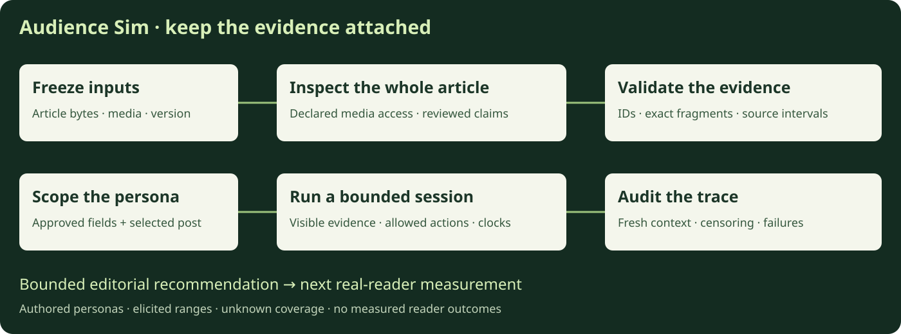

# Audience Sim

[](https://github.com/james-philo-labs/audience-sim/actions/workflows/ci.yml)

An inspectable prototype for a small editorial decision: keep a draft or consider a source-supported edit. Inspect role-specific evidence, separate model judgments from executor outcomes, and state what remains unmeasured.

[Explore the 3DCodeVerse study](https://philo-audience-lab.vercel.app) · [Earlier Opus replay](https://philo-audience-lab.vercel.app/opus.html) · [Compare the Opus articles](https://philo-audience-lab.vercel.app/compare.html) · [System design](docs/architecture.md) · [Recorded case study](docs/case-study.md)



The unit is **one article × one authored persona × one declared condition**. A persona is a hypothesis about a role, not an interviewed individual or a population estimate. Predictions carry elicited ranges with unknown coverage. Statistical confidence intervals stay `null` until real-reader data support calibration.

## Latest study: 3DCodeVerse

**KEEP the source-reconciled baseline A.** All nine assigned browser sessions were attempted and audited (three per authored role); all finished and recommended KEEP. Two rejected policy actions recovered in their original sessions. No new source-supported edit or B rerun was warranted. Human outcomes: **0**, collection excluded; accuracy, comprehension and calibrated probabilities remain unmeasured.

[All nine outcomes and evidence limits](docs/3dcodeverse-study.md) · [Design enhancements](docs/design-enhancements.md) · [Nine metric definitions](docs/metrics.md) · [JSON](results/3dcodeverse-2026-10-20/study.json) · [CSV](results/3dcodeverse-2026-10-20/runs.csv)

The release adds selected-post scope, constrained rich layout, shared interest anchors, bounded media recovery and read-only path/clock summaries. Variable dwell, backtracking, skip, seeking and early exit were existing capabilities. Reader validation is an explicit open question, not a capability certified by software tests. The static `site/` source powers the new public study view; the existing Opus replay and article readers remain separate hosted history. Visitors trigger no inference.

## What this repository contains

- A text/selected-still forecast CLI that freezes its article, scoped persona, prompt, schema, model settings and request.
- An isolated browser session executor, derived from runtime 0.4: bounded actions, future-content withholding, evidence IDs, executor-derived quotes, separate clocks and an independent trace auditor.
- Read-only JSON/CSV trace summaries with section paths, replay coverage, failure and cap visibility, and explicit authored-fixture labels.
- Local bundle preparation, timing-checked GIF playback representations, and native-media observation probes with explicit audio policy.
- A whole-article inspection schema and per-citation validator. Provider-specific comparison orchestration remains outside this compact release; the [design](docs/architecture.md) explains how it fits.
- Tiny authored articles/media, offline tests, browser probes, and a public-safe summary of the recorded two-treatment study, including exclusions and a failed run.

The public package is a portable derivative. It does not claim byte-for-byte equivalence to historical runs. The full articles, third-party media, videos, raw experiment archives and deployment records are not vendored here. The existing [recorded app](https://philo-audience-lab.vercel.app) remains available to inspect the articles and saved evidence; visitors trigger no model calls.

## First run: no credentials or model calls

Python 3.10+ is sufficient for the text path; Node 22+ and FFmpeg/FFprobe are needed for media/browser work.

```sh
git clone https://github.com/james-philo-labs/audience-sim.git
cd audience-sim
python3 engine/reader.py --post example --persona visual-agent-researcher \
  --article examples/article-a.md --article-version a-v1 --model authored-fixture \
  --decision-timestamp 2026-10-18T12:00:00-07:00 \
  --fixture examples/authored-response.json --out runs/text-fixture
```

Open `runs/text-fixture/run.json` and `result.json`. They must say `authored_fixture`, `inference_ran: false` and `not_calibrated`. The values are arbitrary test data.

For the browser path, first ensure `ffmpeg` and `ffprobe` are on `PATH`:

```sh
npm ci
npx playwright install chromium
python3 engine/bundle.py --article examples/article-a.json --out runs/bundle-a
python3 engine/session/session_reader.py prepare \
  --bundle runs/bundle-a --model authored-fixture --out runs/session-a
python3 engine/session/session_reader.py fixture-run --out runs/session-a
python3 engine/session/audit.py --out runs/session-a
```

The expected audit status is `verified_authored_trace_not_a_simulated_read`, with `provider_calls: 0`. This scripted policy tests the request/executor/audit path; it is not a model acting as a reader. Use a fresh output directory for every attempt. [Commands, live opt-ins and artifacts →](docs/running.md)

## Why the design separates its paths

| Path | What it can inspect | What its output means |
|---|---|---|
| Whole-article forecast / rich inspection | Full supplied text and explicitly attached evidence | Editorial feedback under declared access; no observed read |
| Native-media observer | A bounded supplied clip with declared audio policy | Descriptive observations pending source review; no persona score |
| Bounded session | Only encountered viewport fragments, images and sampled playback frames | A trace that can be called a simulated read only after audit |
| Real-reader measurement | Consented actual exposure and outcomes | Evidence needed to evaluate predictive accuracy and editorial value |

The browser session is **muted**, with motion activated on request. Native observer audio access does not silently carry into that session. A citation can be structurally valid and still fail to support a claim.

## What the earlier Opus case taught us

The visual-agent full-text forecast favored treatment B on completion likelihood. A separate bounded reading trace finished A and abandoned B. The methods exposed different content; neither establishes a causal treatment effect. Two initial evaluation-researcher forecasts were excluded for a wrong-scope persona input. A separately declared scope repair produced a new pair; it did not rehabilitate the excluded outputs.

The editor preferred B. **Measured real-reader outcomes: zero.** That case proposed a 24-reader diagnostic, balanced within three roles and randomized within role. It was not run and is not a powered efficacy trial or a calibration certificate. The later 3DCodeVerse study excluded reader collection. [Results, failure cases and measurement plan →](docs/case-study.md)

## Inspect and contribute

```sh
npm test                 # deterministic Python tests; transport is mocked
npm run test:browser     # real local Chromium; authored policy only
npm run test:study       # new static study UI, all nine runs, metrics and mobile reflow
npm run check:public     # release inventory, links, size and sensitive-content checks
```

Start with [the architecture](docs/architecture.md), [the runtime contract](engine/session/contract.md), and [validity and limitations](docs/validity.md). A useful contribution reproduces one failure, adds a falsifying fixture, or improves a documented boundary. See [CONTRIBUTING.md](CONTRIBUTING.md).

## Scope and licensing

No memory service, synthetic population, live public inference backend or general-purpose agent platform is included. Model access, SDK/API compatibility and pricing depend on the account and must be checked before an explicitly requested live run. This publication and CI make no new provider requests.

No open-source reuse license is included in this initial public release. Dependencies and linked content retain their own licenses. [Publication scope and asset provenance →](docs/publication-scope.md)
