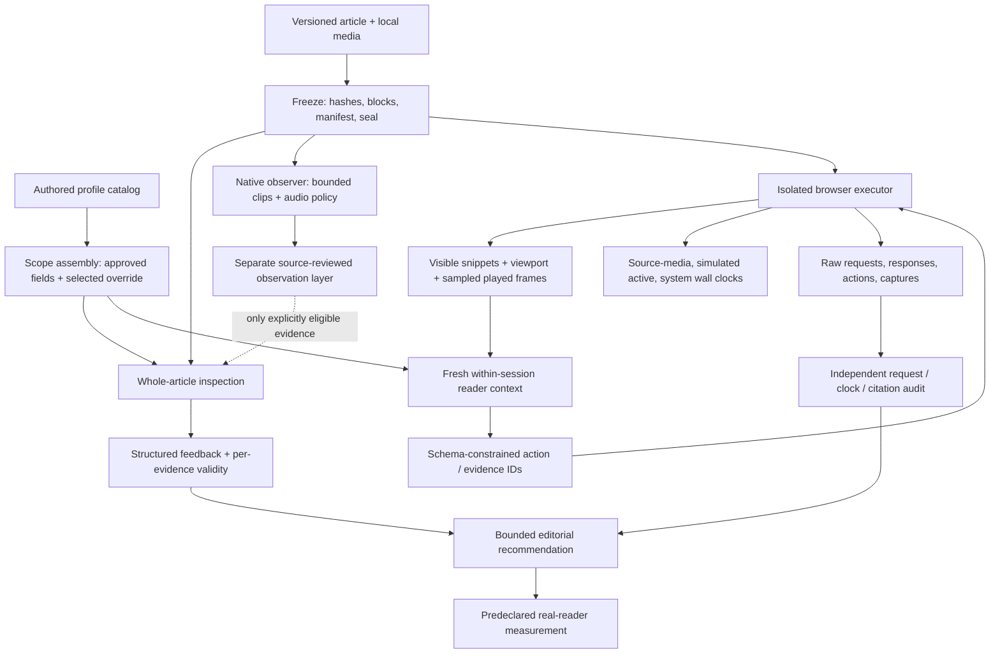

# System design

The system supports a bounded editorial decision. It estimates how an authored professional reader might respond, keeps the supporting evidence inspectable, and identifies the next observation needed from real readers. It does not establish audience demand or a treatment's causal effect.

## Data flow

The dotted observation-to-inspection edge is a review gate. It does not feed a summary of future content into session mode.

## Components and contracts

| Component | Implementation | Input → output | Boundary |
|---|---|---|---|
| Text forecast | [`reader.py`](../engine/reader.py) | Explicit article + scoped persona → prepared request or validated response | No implicit fetching; video/audio/layout unavailable |
| Persona projection | [`personas.py`](../engine/personas.py) | Authored catalog + selected post → approved flat fields | Unrelated override catalogs and nested payloads stay out |
| Bundle | [`bundle.py`](../engine/bundle.py) | Local article spec + explicit media → frozen site/manifest/seal | Escaped text, no arbitrary source HTML or remote imports |
| Native observation | [`observer.py`](../engine/native_perception/observer.py) | Bounded clip + audio policy → descriptive events | Requested sampling is not proof of continuous provider coverage |
| Inspection validity | [`inspection.py`](../engine/inspection.py) | Finding + evidence catalog → citation integrity report | Semantic support remains pending source review |
| Reader policy | [`session_reader.py`](../engine/session/session_reader.py) | Revealed within-session evidence → one bounded action | No full article, future headings, external tools or other-session results |
| Browser | [`browser_rpc.cjs`](../engine/session/browser_rpc.cjs) | Allowed action → actual local browser result and captures | Off-origin requests blocked; hidden targets rejected; media paused during decisions |
| Auditor | [`audit.py`](../engine/session/audit.py) | Frozen inputs + complete raw trace → validity report | Reconstruct requests, evidence references and clocks; preserve failures |

## Freeze and address evidence before interpreting it

An article's label is insufficient: hash its exact bytes and assign block identities. Each asset has its own source hash, representation, local URL and policy. Preparation produces a file-set seal; edits or substitutions invalidate the prepared run. The public bundle accepts a small article JSON format and renders escaped text into a fixed local shell. Existing rich HTML production capture is outside this portable surface.

A session assigns a new observation ID at each checkpoint. Text fragments, viewport images and played-media frames receive separate evidence IDs. Source block identity and the actually revealed fragment remain distinct. Feedback selects IDs; the executor derives the full supplied fragment verbatim, or `null` for image evidence. It never fills in a nearby paragraph or an unseen closing.

## Make exposure an executor responsibility

The browser calculates character rectangles and includes only fully visible text characters. It excludes closed disclosure bodies and offscreen content. Opening media creates an overlay; that state cannot charge simultaneous article reading. Inline playback can overlap reading. GIFs start as first-frame posters and open as one silent transformed cycle. Native autoplay is a different condition.

The model receives screenshot bytes and sampled rendered playback frames, not the full source video or audio. The executor may know the whole file to render it, but its model-facing projection does not expose the source HTML, complete asset inventory or unseen sections. This boundary is tested with sentinel content and exact request reconstruction.

## Freeze forecast origin; distinguish feedback

The first-action schema requires an initial forecast from the first viewport. Later schemas require `initial_forecast: null`. Terminal feedback is retrospective and cannot become an advance forecast for that same trace. Action evidence references are constrained to an enum of encountered IDs. Unknown IDs fail closed; schema-limit exhaustion is a stopped attempt, not permission to truncate away evidence.

## Keep three clocks

1. **Source-media time:** actual browser playback positions and sampled frame timestamps. A seek changes position but adds no watched duration for skipped footage.
2. **Simulated active time:** model-elicited read durations plus authored interaction costs and executed playback; overlapping intervals count once.
3. **System wall time:** API latency, browser operations, preparation and audit. It is not reader attention or reading speed.

A cap is censoring. An error is failure. An explicit abandon is a terminal choice. None can be converted to a completed ten-minute read. Reaching the declared closing permits finishing; comprehension and optional media coverage remain separate.

## Review observations without rewriting history

Native outputs stay raw. A reviewed layer should identify each original event, disposition (`bounded`, `attributed`, `withheld`), replacement observation IDs, exact source/frame references and unresolved uncertainty. Displayed labels remain attributed. Sound claims need explicit interval-level listening evidence or a muted-only scope. Sparse samples cannot establish continuous absence or exact transitions.

The portable native probe records raw outputs and structural checks but **does not automatically open the observation-to-persona gate**. Its output retains `persona_scoring_connected: false`. The project-specific historical adjudications are intentionally not a general reusable approval rule.

## What persists

Run directories persist for audit. A later session does not retrieve them. Every session starts with an empty evidence/history state and a new browser context. Provider calls resend only allowed within-session history, with `store: false` and no conversation or previous-response ID. These client-side choices do not make a claim about provider-side retention beyond the selected API controls.

## Why a portable derivative

Historical scripts were coupled to specific articles, review layers and local tools. Public release 0.1 keeps the current session mechanics and validators while changing paths, input selection, persona projection and configurable cost estimates. It adds an explicitly authored end-to-end fixture. No inference establishes behavioral equivalence to the original runtime; historical results remain attached to their original conditions. [Release differences →](release-notes.md)

## API references

The request shapes are grounded in the official [OpenAI Structured Outputs guide](https://developers.openai.com/api/docs/guides/structured-outputs) and [Gemini Interactions overview](https://ai.google.dev/gemini-api/docs/interactions-overview), checked October 18, 2026. These documents describe API contracts; they do not validate a selected model's account compatibility or this harness's predictive accuracy. Local schema validation is an additional guard over the subset used here.
